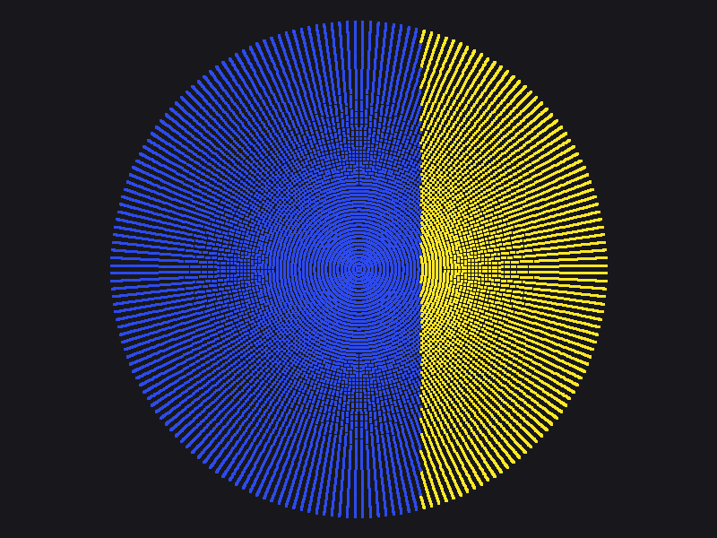

# osview-rs

[](https://github.com/ChasLui/osview-rs/actions/workflows/ci.yml)
[](LICENSE)



OpenScene's `osview` core with one renderer shared by a CLI, an optional
interactive GUI, a C SDK and a Rust library: reads a PLY point cloud plus
per-point CLIP features, scores one query vector, and renders the result. No
GLUT, no GPU, no CLIP server.

Reproduced semantics (from `osview.cpp` in the OpenScene demo):

- the i-th feature row belongs to the i-th PLY vertex (pairing is by index,
  not name);
- feature rows are L2-normalized on load; zero rows stay zero and never match;
- score = dot product of the row with the (normalized) query vector = cosine;
- points with `score < --range-min` keep their PLY vertex color (grey when the
  PLY lacks a full `red green blue` triplet); the rest use a
  blue→yellow ramp between `--range-min` and `--range-max` (osview defaults
  0.05 / 0.10).

Not implemented: CLIP text encoding (pass a `.npy` text embedding instead),
`.ssa/.conf` scenes, per-image feature files (`-image_directory`).

## Build

```bash
cargo build --release                  # CLI: target/release/osview-rs
cargo build --release --features gui   # + GUI: target/release/osview-gui
cargo install --path .                 # CLI into ~/.cargo/bin
```

`cargo build` always produces `libosview_rs.a` / `.dylib` / `.so` too (honours
`CARGO_TARGET_DIR`).

## Surfaces

| surface | entry point | notes |
| --- | --- | --- |
| CLI | `osview-rs` | batch render + JSON report; the flags below |
| GUI | `osview-gui` (`--features gui`) | live orbit/pan/zoom on the same CPU renderer |
| C SDK | `include/osview.h` + `libosview_rs` | opaque handle, camera/matches structs; `examples/c/smoke.c` |
| Rust library | `osview_rs::{Dataset, Camera, render}` | validation/scoring/report without CLI plumbing |

GUI controls: drag to orbit, right/shift-drag to pan, wheel to zoom, `1`/`2`/`3`
for the view, `[`/`]` for the ramp top, `r` to reset, `q`/Esc to quit. Smoked
with `--frames N` (renders N frames, prints the painted-pixel count, exits).

```bash
osview-gui --points region0.ply --features RPmz2.npy --query chair.npy
```

C SDK: create a handle, load the three inputs, score, then render into your own
RGB buffer or pull top-k matches. See `include/osview.h` for the ABI and
`examples/c/smoke.c` for a complete loader/render/query program.

## Usage

```bash
osview-rs --points region0.ply --features RPmz2sHmrrY_region0.npy \
          --query chair.npy --out chair.png --report chair.json \
          --view xy --width 1600 --height 1200 --range-min 0.05 --range-max 0.10
```

Inputs

- `--points`: PLY, `ascii` or `binary_little_endian`, vertex `x y z` plus
  optional `red green blue` (uchar or float 0-1).
- `--features`: `.npy` `[N, D]` float16/32/64, C order. `D` is whatever width
  produced them (CLIP ViT-L/14 → 768).
- `--query`: `.npy` `[1, D]` or `[D]` — a CLIP text embedding in the same space
  as the features (e.g. `[1, 768]` float32).
- Camera (optional): `--yaw`/`--pitch` rotate the cloud about the vertical and
  horizontal screen axes before projection; `--zoom` scales about the image
  centre; `--pan-x`/`--pan-y` shift the result in pixels. Defaults
  (`0/0/1/0/0`) reproduce the axis-aligned views.

Outputs

- PNG (`--out`): orthographic projection on `xy`, `xz` or `yz`; the depth
  buffer keeps the splat with the largest coordinate on the depth axis (camera
  on the +axis); `--radius` is a square half-width in pixels (0..=64).
- JSON report (`--report`): `points`, `dim`, `view`, `camera` (`yaw`, `pitch`,
  `zoom`, `pan`), `range`, `above_min`, and `matches` (`i`, `score`, `p` per
  point) for the top `--topk` points.
- stdout: one-line JSON summary with the top 10.

Query vector: save any CLIP text embedding in the same space as the features
as `.npy` — OpenScene's `demo/clip_server.py` does this upstream.

## Tests

```bash
cargo test --release     # NPY, PLY, renderer and Dataset tests
cargo run --release -- --selftest   # ranking, render coverage, ascii PLY
cargo clippy --release --locked --features gui --all-targets -- -D warnings
```

## Demo

`demo/gen_demo.py` builds a 40k-point sphere with 768-d float16 features
(the query highlights the +x hemisphere). Generated data is git-ignored:

```bash
cd demo && python3 gen_demo.py && cd ..
osview-rs --points demo/sphere.ply --features demo/feats.npy \
          --query demo/query.npy --out demo/render.png \
          --width 800 --height 600 --range-min 0.05 --range-max 0.32 \
          --report demo/top.json
```

## Notes

- Point splatting, not surface rasterization: thin geometry shows as dots.
  Increase `--radius` or resolution for denser coverage.
- CLI views are axis-aligned orthographic; `--yaw`/`--pitch` rotate the cloud
  about the screen axes for turntable-style framing, and the defaults keep the
  axis-aligned output. The GUI drives the same camera interactively.
- Scoring is single-query. For class argmax, loop over class vectors and keep
  the max per point, then reuse the same renderer.

## Non-goals

- GPU rasterization: the GUI presents the same CPU splats as the CLI, keeping
  pixels identical across surfaces.
- CLIP text encoding in the binary: pass a precomputed `.npy` embedding
  (upstream `osview` also shells out to Python/TCP for this).
- `.ssa/.ssb/.conf` OpenSurfels scenes and `-image_directory` per-image
  features: those need scene cameras and surfels; export a PLY + `.npy` pair.

## Development

`scripts/verify.sh` runs CI parity (fmt, clippy on all targets, tests,
`--selftest`), builds the GUI, compiles/links the C SDK example, and runs a demo
render plus the C smoke test when the fixtures exist. See
[CONTRIBUTING.md](CONTRIBUTING.md) for PR expectations.

## Agent integration

- [AGENTS.md](AGENTS.md) — commands, invariants and the verification loop for
  coding agents; [CLAUDE.md](CLAUDE.md) and
  [.github/copilot-instructions.md](.github/copilot-instructions.md) point to it.
- `skills/osview-rs/SKILL.md` — runtime usage skill for agents driving the CLI
  (flags, outputs, jq recipes, error table), symlinked at
  `.claude/skills/osview-rs` for Claude Code.
- [docs/report.schema.json](docs/report.schema.json) — JSON Schema for the
  `--report` output.
- `scripts/verify.sh` — one-command verification.

## License

MIT — see [LICENSE](LICENSE). Security reports: [SECURITY.md](SECURITY.md).
